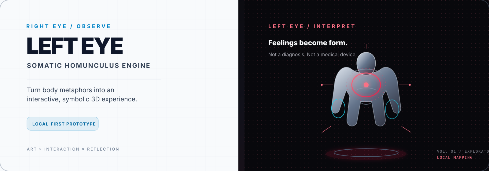

<div align="center">
  

  <h1>LEFT EYE</h1>
  <p><strong>Feelings become form.</strong></p>
  <p>An experimental, local-first 3D body-metaphor visualizer built for creative reflection, interaction design, and hackathon demos.</p>

  <p>
    
    
    
    
  </p>

  <p>
    <a href="SECURITY.md">Security &amp; privacy</a> ·
    <a href="TEST_REPORT.md">Test report</a> ·
    <a href="LICENSE">MIT license</a>
  </p>
</div>

---

> [!IMPORTANT]
> **LEFT EYE is a creative prototype, not a medical device or a validated psychological assessment.** Its local keyword mapping, visual scales, symbolic materials, sample cases, and report language are illustrative. They cannot diagnose a condition, determine the cause of pain, or infer that someone has experienced trauma. Do not use the output to make healthcare decisions.

## The idea

Some experiences are hard to describe literally. LEFT EYE turns a short body-related metaphor—such as “my chest feels heavy” or “my hand feels numb”—into a symbolic, explorable 3D scene.

- **Right Eye** is a restrained, clinical-inspired view for observing the mapped regions.
- **Left Eye** is a dark, manga-inspired view for expressive visualisation.
- The **Clinical Bridge** presents plain-language, exploratory descriptions alongside the visual metaphor.

The result is meant to prompt reflection and conversation, not to tell anyone what their feelings *really* mean.

## Features

- **Interactive 3D figure** — orbit, zoom, auto-rotate, reset the view, and inspect body regions.
- **Dual visual modes** — light / clinical-inspired and dark / manga-inspired themes.
- **One-click demo presets** — three prepared examples for a reliable presentation walkthrough.
- **Local keyword mapper** — maps supported body-part language to illustrative regions, scale values, and symbolic materials.
- **Manual overrides** — explore per-region scale and material variations.
- **Optional on-device speech** — enabled only if the browser explicitly supports local recognition; otherwise, type or use a preset.
- **Experimental camera interaction** — a local brightness heuristic and manual Cover Test; this is not eye tracking.
- **Print / Save as PDF** — export a snapshot of the current exploratory state with a non-diagnostic disclaimer.
- **No AI provider or app backend** — no API key, application API requests, analytics, cookies, or browser storage in this release.

## Quick start

**Requirements:** a current browser with WebGL and Python 3 or another static HTTP server. No dependency install or build step is needed for the demo.

```bash
git clone https://github.com/RajMetry/left-eye-homunculus.git
cd left-eye-homunculus
python -m http.server 5173
```

Open **http://localhost:5173**.

> Opening `index.html` as a `file://` URL is less reliable. Use localhost so browser APIs such as camera access can run in a supported secure context.

To run the static release checks, install Node.js and run:

```bash
npm test
```

## Controls

| Action | How |
| --- | --- |
| Switch Right Eye / Left Eye | Click the eye toggle or press **Space** when focus is not inside a form control |
| Rotate the figure | Drag inside the 3D viewport |
| Zoom | Use the mouse wheel / trackpad in the viewport |
| Inspect a region | Click a body region in the 3D viewport |
| Load a demo case | Choose one of the three **Instant Stage Presets** |
| Change a region's appearance | Use **Live Somatic Override** controls |
| Try the camera interaction | Explicitly enable **Camera Demo**, grant permission, or use **Cover Test** |
| Export a snapshot | Open the report and choose **Print / Save PDF** |

## Privacy by design

This build intentionally has **no AI integration and no API-key field**. It maps input locally and does not contain application-owned `fetch`, XHR, WebSocket, beacon, cookie, `localStorage`, or `sessionStorage` calls.

| Area | Behaviour |
| --- | --- |
| Typed input | Processed by local keyword rules in the browser; not submitted to an app backend |
| Reports | Generated in the current page; saved/printed only when the user chooses to do so |
| Camera | Starts only after an explicit user action and browser permission; the app samples brightness locally |
| Speech | Only attempts recognition when on-device availability is explicitly supported; never falls back to cloud transcription |
| Analytics / cookies | None are included by this project |
| External libraries | Loaded from listed CDNs; providers can still observe ordinary network metadata such as IP address and request time |

The page applies a restrictive Content Security Policy and a `no-referrer` policy. However, CDN-delivered JavaScript still executes in the page, so this is **not equivalent to a fully self-hosted release with integrity-verified dependencies**. See [`SECURITY.md`](SECURITY.md) for the scope and remaining risks. Do not enter real patient details, health records, passwords, or other sensitive information into a public demo.

## Tech stack

- **HTML / CSS / JavaScript** — static front-end; no app server.
- **Three.js r128** — WebGL scene, model geometry, materials, and camera controls.
- **Tailwind Play CDN 3.4.17** — utility styling and theme classes.
- **Lucide 0.468.0** — interface icons.
- **GitHub Actions + GitHub Pages** — optional static deployment workflow.

> Tailwind's Play CDN is convenient for a prototype, but its own documentation recommends it for development rather than production. A longer-term hardened build should compile CSS at build time and self-host version-pinned assets with verified integrity hashes.

## Project layout

```text
.
├── .github/workflows/pages.yml  # automated Pages deployment
├── assets/                      # README banner and favicon
├── scripts/                     # release and local-engine tests
├── index.html                   # accessible UI structure / CSP
├── app.js                       # scene, interaction, and local mapping
├── styles.css                   # local visual styling
├── tailwind-config.js           # theme configuration
├── SECURITY.md                  # scope, privacy, known risks
├── TEST_REPORT.md               # checks and browser smoke-test list
├── CONTRIBUTING.md              # contribution guidance
├── CHANGELOG.md                 # release notes
└── LICENSE                      # MIT
```

## Tests and release checks

```bash
npm test
```

The test scripts check JavaScript syntax, duplicate HTML IDs, referenced elements, core interaction functions, local mapping behaviour, input bounds, text handling, and privacy invariants. These are **static/unit checks**; they do not replace browser testing of WebGL, camera and microphone permissions, printing, or the deployed site.

Before presenting or publishing, follow the browser checklist in [`TEST_REPORT.md`](TEST_REPORT.md).

## Deploy to GitHub Pages

The included workflow at `.github/workflows/pages.yml` runs `npm test`, stages only the app's runtime files, and deploys on pushes to `main`.

1. Create the public repository **`RajMetry/left-eye-homunculus`** with GitHub’s **Add a README file** option enabled (this creates the default branch). Leave the `.gitignore` and license options unset; both are included here. The starter README will be replaced by this project README.
2. Add the project files to the `main` branch and push the commit.
3. In **Settings → Pages → Build and deployment**, select **GitHub Actions** as the source.
4. Open the **Actions** tab and confirm **Deploy LEFT EYE to GitHub Pages** succeeds.
5. Use the deployment summary for the exact published URL, then smoke-test that live site.

No secrets or API keys are needed for deployment.

## Roadmap

- [ ] Self-host version-pinned dependencies and replace the development CDN with a production CSS build.
- [ ] Add an automated browser smoke test for the public Pages URL.
- [ ] Add a captured desktop/mobile screenshot after real-browser verification.
- [ ] Improve keyboard navigation and reduced-motion support.
- [ ] Continue reviewing privacy boundaries and descriptive, non-diagnostic language.

## Contributing

Bug reports, accessibility feedback, docs improvements, and small focused pull requests are welcome. Please read [`CONTRIBUTING.md`](CONTRIBUTING.md) first. Do not submit private health information, personal identifiers, API keys, or recordings in issues or pull requests.

## License

MIT — see [`LICENSE`](LICENSE).

---

<div align="center">
  <sub>Built as an exploratory interface for the spaces between language, sensation, and visual storytelling.</sub>
</div>
